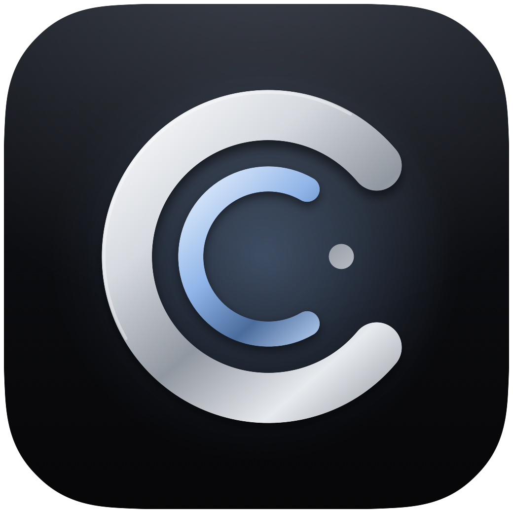

<p align="center">
  
</p>

<h1 align="center">Corres</h1>

<p align="center"><em>Email, considered.</em></p>

<p align="center">An email app for iPhone and iPad, built in SwiftUI.<br>
Gmail, Outlook, iCloud and almost any other account in one inbox, read and sorted on your device.</p>

---

Most mail apps answer "what did I receive?" Corres answers "what needs me?" It opens on Needs You, with the replies you're owed one row above, and every message is still one swipe along in Mail. Nothing is sorted out of reach.

Built by [Anwar Creative Studio](https://anwarcreativestudio.com), alongside Artha. Status: in beta on TestFlight. Website: [corres.app](https://corres.app).

## What it does

**One home, opening on what needs you**
- **Needs You:** conversations that ask something of you, each with a one-line reason, grouped into Due soon and When you can. Press and hold any conversation to move it if Corres got it wrong, and it learns.
- **Waiting:** conversations you replied to or moved there, with how long you've been waiting and a nudge when it's time to follow up.
- **Mail:** Primary, Everything, Unread, Promotions, Social and Updates, sorted by Corres's own rules on top of each provider's, across every account or one at a time.
- **New senders:** a first email from someone new waits for Allow or Block. Allow or block a whole company at once.
- **Search that answers:** search every account with `from:`, `to:`, `has:attachment`, `is:unread` and `is:flagged`, or type a question ("When is my next flight?") and get the answer from your own mail above the results.

**Every account**
- Gmail and Google Workspace, Outlook.com and Microsoft 365, iCloud Mail, and Yahoo, AOL, Fastmail, Zoho or a work server with just an address and password.
- Postwright, our own IMAP and SMTP engine (`Packages/Postwright`), for iCloud and other accounts.
- New Outlook and iCloud mail notifies in seconds, even with Corres closed.

**A complete mail app**
- Whole conversations: earlier messages appear as compact rows above the latest one, open in place, and long threads fold in the middle.
- Read, reply, reply all, forward and compose, with attachments, Send Later, Undo Send, follow-up reminders, signatures, send-as addresses, and bold, lists and links.
- Undo after Archive or Trash; Archive and Mark as Read from a notification; a reply straight from a notification.
- Works offline: archive, delete, move, read and flag wait on the device and reach the server in order once it can.
- Your choices (Needs You, Waiting and Handled, snoozes, pins, allowed and blocked senders, VIPs and settings) sync between your devices through iCloud. Mail itself never does.
- Apple Mail's keyboard shortcuts on iPad and hardware keyboards, and a three-column layout on iPad.
- Needs You and Waiting widgets, Siri and Shortcuts ("What needs me in Corres"), and a Morning Brief notification.
- Snooze by typing a time ("in 3 days at 9am") or picking a preset; Pin; four custom swipes.

**Shaped around you**
- Settings → Customize: lists, swipes, and up to five actions under an email from 18; the rest wait in ⋯.
- Mailboxes → Edit: show, hide and reorder mailboxes and labels.

**Reading**
- Designed mail fits the screen with a Dark mode mapped like Mail's; images, trackers and Unsubscribe share one line under the sender.
- Quoted history folds behind •••; plain-text mail gets the same rendering.
- Receipts, deliveries and bills show the amount, date and order number at the top, on any iPhone.

**Intelligence, on the device only**
- Rules sort first and work on every iPhone; with Apple Intelligence (Foundation Models), Corres refines Needs You and adds summaries, suggested replies and rewrites.
- Every summary and reason is checked against the email itself before you see it.
- There's no cloud fallback.

**Private by design**
- Sign-in is with your provider directly. Corres stores only revocable tokens or an app-specific password, in the Keychain.
- Remote images and tracking pixels are blocked until you choose to show them. Read receipts are never sent.
- No advertising or analytics code. Removing an account removes its mail from the device.
- Settings → Send Diagnostics shares freeze and crash reports, never mail.

## Gmail scopes

`gmail.readonly`, `gmail.send`, `gmail.modify`. `gmail.send` is a Google "sensitive" scope; `gmail.readonly` and `gmail.modify` are "restricted", so a public release needs Google's OAuth verification plus an annual CASA security assessment. See ADR 005 in [Docs/Architecture.md](Docs/Architecture.md).

## Tech stack
- SwiftUI, iOS 17 minimum (Liquid Glass and Foundation Models features on iOS 26), Swift 6 strict concurrency.
- `CorresCore`: a Swift package holding the provider-independent domain and persistence layer (SwiftData), tested on macOS.
- One dependency: [GoogleSignIn-iOS](https://github.com/google/GoogleSignIn-iOS), for Google sign-in. Microsoft sign-in uses the system web sheet, and IMAP and SMTP are our own (Postwright).
- Swift Testing for the domain suite.

## Running locally
Open `Corres.xcodeproj` in Xcode, select the **Corres** scheme and a simulator or your iPhone, then Run. For a device, set your team in Signing & Capabilities. Without an account, Corres opens with fictional sample mail.

```bash
xcodebuild -scheme Corres -destination 'generic/platform=iOS Simulator' build
```

The checked-in `Corres.xcodeproj` is the source of truth (it carries entitlements, the widget extension and embed phases that `Scripts/generate_project.py` predates, so don't regenerate from that script). Add new files through Xcode. The app icon and launch mark are rendered from the vector mark by `Scripts/RenderIcon.swift`.

## Running tests
```bash
swift test --build-path /tmp/corres-swift-build
```
The separate build path avoids a code-signing quirk when the repository lives in a synced folder.

## Releasing

- **TestFlight beta:** `Scripts/testflight.sh`. Beta builds include Pro for testers (`-D CORRES_BETA`, and only when installed from TestFlight or Xcode, never from the App Store).
- **App Store:** `Scripts/appstore.sh`, and submit *that* build number for review. Never submit a TestFlight beta build: App Review runs in the sandbox too, so the reviewer would get free Pro and the review would be rejected. The script refuses to upload if the beta flag got in.

[Product specification](Docs/Product.md) · [Architecture decisions](Docs/Architecture.md) · [Design system](Docs/Design.md) · [Research](Docs/Research.md) · [Verification record](Docs/Verification.md)
